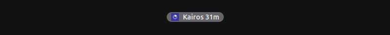
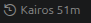

<h1 align="center">Kairos Tab Time</h1>

<p align="center">
  <em>Your time vibe-coding, on your screen</em>
</p>

<p align="center">
  
</p>

<p align="center">
  <a href="https://github.com/hackclub/kairos"></a>
    <a href="https://hackclub.com/"></a>&nbsp;

</p>


## GNOME top bar

<p align="center">
  
</p>

**[Install the GNOME extension →](https://github.com/christianwell/kairos-tab-time/blob/main/gnome-extension/INSTALL.md)**

## VS Code companion



Install [Kairos](https://github.com/hackclub/kairos) on the same computer as VS Code. From this repository, run:

```sh
sh install-vscode.sh
```

Reload the VS Code window after installation. The status bar shows today's Kairos focus time; click it to open the dashboard. If Kairos is unavailable, it shows `Kairos —` and retries every 15 seconds. Run **Kairos: Refresh Tab Time** from the Command Palette to check immediately. To update, pull the latest code and rerun the installer. To remove it, uninstall **Kairos Tab Time** from VS Code's Extensions view.

For development, open this folder in VS Code and press **F5** to launch an Extension Development Host. Run `npm test` for unit tests; `npm ci && npm run package` builds a standalone VSIX. The GNOME extension lives separately in `gnome-extension/`.

The bundled icon is copied from [Kairos's browser extension](https://github.com/hackclub/kairos/tree/main/extension/src/icons) (upstream AGPL-3.0).
