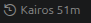

# Kairos Tab Time for VS Code

Shows today's [Kairos](https://github.com/hackclub/kairos) focus time in the bottom-right status bar. Kairos must be running on the same computer as VS Code.



## Install

Open the [VS Code install guide on the website](https://kairos-tab-time.christianwell.xyz/#vscode), or, with the VS Code `code` command available, install the latest release without a repository checkout or Node.js:

```sh
curl -fsSL https://kairos-tab-time.christianwell.xyz/install-vscode.sh | sh
```

Or download the `.vsix` from [Releases](https://github.com/christianwell/kairos-tab-time/releases) and use Extensions → ⋯ → Install from VSIX. From the [repository root](https://github.com/christianwell/kairos-tab-time), `sh vscode-extension/install.sh` still builds and installs it (requires Node.js and npm).

Reload VS Code after installation. Click **Kairos** in the status bar to open the dashboard. If Kairos is unavailable, it shows `Kairos —` and retries every 15 seconds. Run **Kairos: Refresh Tab Time** from the Command Palette to check immediately. To update, rerun the installer or install a newer VSIX; to remove it, uninstall **Kairos Tab Time** from VS Code's Extensions view.

## Develop

Open `vscode-extension/` in VS Code and press **F5** for an Extension Development Host. Run `npm ci && npm test` to check it and `npm run package` to build a VSIX.
